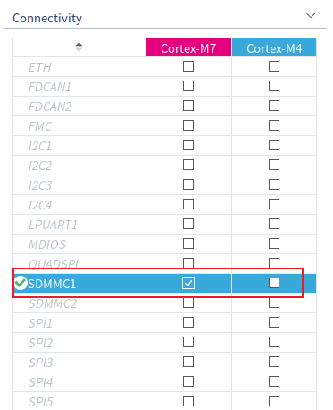
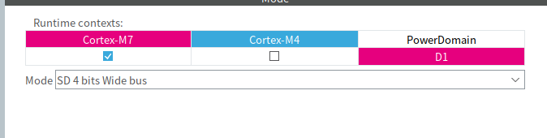
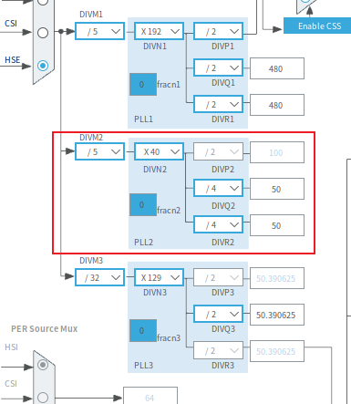
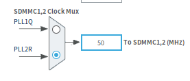
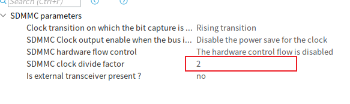
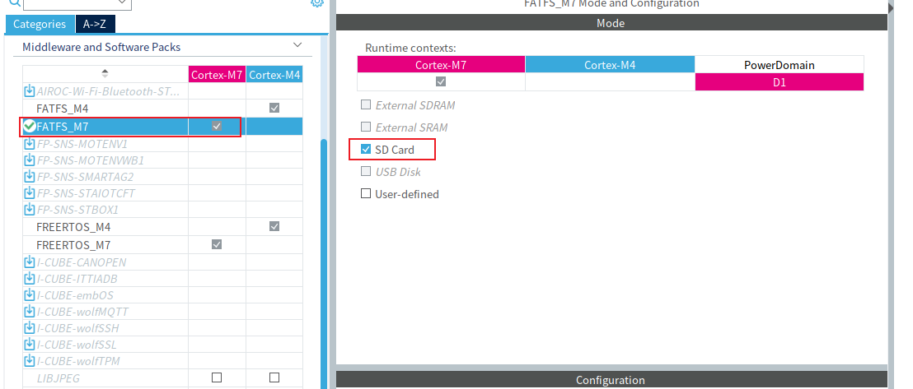
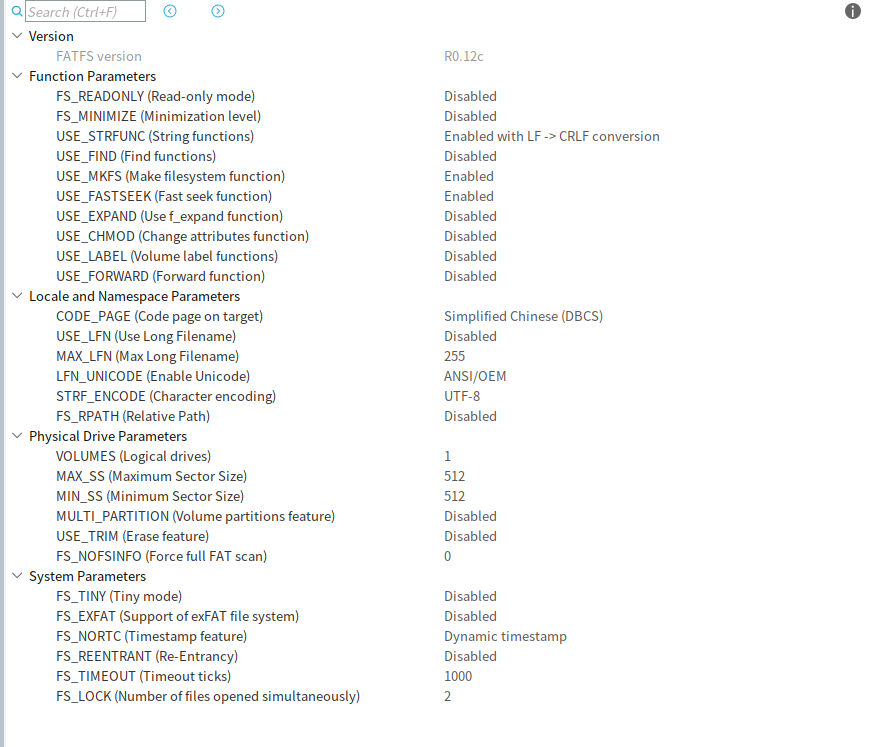

# 第一部分：TF卡与文件系统基础

## 1. TF卡的外形与容量类别

TF卡是 **microSD 卡**的常用叫法。它是一种可拆卸的闪存卡：卡内控制器管理闪存，向主控提供按地址访问的存储空间。主控通常不直接处理闪存的物理页和擦除块。

microSD 描述的是**外形**。SD、SDHC、SDXC、SDUC 描述的是**容量类别**，分别对应不超过 2 GB、超过 2 GB 至 32 GB、超过 32 GB 至 2 TB、超过 2 TB 至 128 TB。容量类别与使用 SPI 还是 SD 总线通信是两回事。

## 2. SPI模式与SD总线模式

TF卡主要有两种通信方式：

| 模式         | 信号                         | 数据传输方式           |
| ------------ | ---------------------------- | ---------------------- |
| SPI          | `CS`、`SCK`、`MOSI`、`MISO`  | 通过 SPI 收发数据      |
| 原生 SD 总线 | `CLK`、`CMD`、`DAT0`～`DAT3` | 可使用一根或四根数据线 |

在 SD 一位模式下使用 `DAT0`；四位模式下同时使用 `DAT0`～`DAT3`。**SDMMC 是某些主控上用于访问 SD 总线的外设名称，不是卡的第三种通信模式。**例如，STM32H7 的 SDMMC 实现原生 SD 总线，不实现卡的 SPI 模式。

## 3. 逻辑扇区与块读写

无论采用哪种通信方式，存储卡都会向主控提供可寻址的数据块。文件系统通常把按地址编号的读写单位称为**逻辑扇区**；常见 SDHC、SDXC 卡的数据块长度为 512 字节。逻辑扇区是对主控呈现的地址单位，不等同于卡内闪存的物理页。

块读写只能表达“读取第几个扇区”，不能表达“打开哪个文件”。文件系统通常把若干连续扇区组成一个**簇**，再用目录和分配信息记录文件占用了哪些簇。

## 4. FAT文件系统与FatFs

**FAT32、exFAT 是卡上的文件系统格式；FatFs 是主控上读写这些格式的软件**。格式化会在存储介质上建立文件系统所需的结构。以下用 FAT32 说明文件是怎样找到的：

- **目录项**记录文件名、文件大小和起始簇。
- **数据区**按簇保存文件内容，一个文件可以占用多个簇。
- **文件分配表**记录簇之间的连接关系，使系统能从起始簇找到文件后续的数据。

例如，目录项指出某文件从簇 5 开始，FAT 表记录“簇 5 后面是簇 9”，文件系统便能继续读取簇 9。应用只需指定文件名；文件系统负责把文件操作转换为扇区读写。

FAT32 单个文件最大约 4 GB；exFAT 支持更大的文件，并采用不同的数据分配结构。SD 协会将 SDHC 对应 FAT32、SDXC 对应 exFAT，但**卡的容量类别不等于主控的软件一定支持相应格式**。

> Windows 常用 NTFS，也支持 FAT32 和 exFAT；Ubuntu 常用 ext4，并可读写 FAT32，具备相应驱动时也可读写 exFAT 和 NTFS。若 TF 卡需要在 Windows 与 Ubuntu 之间交换文件，通常选择 FAT32 或 exFAT；还要确认使用这张卡的嵌入式设备支持所选格式。

FatFs 向应用提供打开、读取、写入文件等接口，并通过底层磁盘读写接口访问扇区。能否使用 exFAT、长文件名等功能，取决于所用 FatFs 版本及其配置。

# 第二部分：STM32H747的SDMMC配置

## 1. TF卡座与SDMMC1的信号连接

本工程的 TF 卡座通过原生 SD 总线连接到 **SDMMC1**。CubeMX 中选择 SDMMC1，是由电路连接决定的：卡座的六根通信信号线分别接到了 SDMMC1 对应的引脚。

| TF 卡信号 | STM32H747 引脚 | 作用 |
| --- | --- | --- |
| `CLK` | `PC12` | 主控输出时钟 |
| `CMD` | `PD2` | 发送命令、接收响应 |
| `DAT0` | `PC8` | 数据线 0 |
| `DAT1` | `PC9` | 数据线 1 |
| `DAT2` | `PC10` | 数据线 2 |
| `DAT3` | `PC11` | 数据线 3 |

卡座由 3.3 V 供电，电源旁接有去耦电容。`CMD` 和四根 `DAT` 线各有一个 10 kΩ 上拉电阻；`CLK` 是主控输出的时钟信号，没有配置上拉。生成的 GPIO 配置使用 SDMMC 复用功能，内部上下拉设为 `No pull`，与板上的外部上拉相对应。

卡座的机械卡检测触点 `CD` 可以不连接主控；不连接时，仍可通过 SDMMC 与 TF 卡通信，但无法通过该触点直接判断是否插卡。本工程未连接该触点，也没有配置插卡检测 GPIO。

## 2. 四位总线模式与CM7外设归属

卡座接出了 `DAT0`～`DAT3`，因此在 CubeMX 中将 **SDMMC1** 设为 `SD 4 bits Wide bus`，并将该外设分配给 **Cortex-M7**。





四位模式表示数据传输时可以同时使用四根数据线。初始化卡片时，HAL 会先使用一位总线完成识别，再将卡和 SDMMC 切换到配置的四位模式。因此，CubeMX 中选“四位模式”不表示上电后第一条命令就通过四根数据线发送。

## 3. SDMMC时钟来源与分频配置

SDMMC 的时钟分两层：**内核时钟**供给 SDMMC 外设，外设再分频产生送往 TF 卡的 `CLK`。本工程在 CubeMX 中选择 `PLL2R` 作为 SDMMC 内核时钟，其配置为：





```text
25 MHz HSE ÷ 5 × 40 ÷ 4 = 50 MHz
          PLL2M  PLL2N  PLL2R
```

因此，SDMMC 内核时钟为 **50 MHz**。SDMMC1 的 `ClockDiv` 配为 `2`。



按本工程使用的 STM32H7 HAL 分频关系，数据传输阶段送往卡的时钟为：

```text
SDMMC_CK = 50 MHz ÷ (2 × ClockDiv)
         = 50 MHz ÷ (2 × 2)
         = 12.5 MHz
```

这里的 `ClockDiv = 2` 并不表示直接用 50 MHz 除以 2。卡片初始化阶段还需要更低的时钟：HAL 会临时设置分频，使初始化时钟不超过 400 kHz；完成识别后，再使用配置的传输时钟。

生成的其余参数为上升沿采样、关闭时钟省电模式、关闭硬件流控制，并且不使用外部收发器。这些参数与当前的 3.3 V TF 卡连接方式相对应。

# 第三部分：STM32H747的FatFs配置

## 1. 启用FatFs并选择SD Card

在 CubeMX 的 `Middleware and Software Packs` 中，为 **Cortex-M7** 启用 `FATFS_M7`，然后在模式中勾选 `SD Card`。这样，FatFs 会以 TF 卡作为存储介质，通过底层磁盘接口读取和写入扇区。



这里选择的是 **FatFs 使用哪种存储介质**；上一部分的 SDMMC 配置负责主控与卡之间的通信。两者都需要配置，应用才能按文件名读写 TF 卡。

## 2. FatFs配置项的含义

本工程使用的 FatFs 版本为 **R0.12c**。下图是 CubeMX 中的配置项；表中的“关闭”表示该可选功能未启用，不代表整个 FatFs 被关闭。



**文件操作功能**

| 配置项 | 当前设置 | 含义 |
| --- | --- | --- |
| `FS_READONLY` | 关闭 | 允许读写文件；启用只读模式后，写入和删除等接口将不可用。 |
| `FS_MINIMIZE` | 关闭 | 不裁剪基本文件操作接口。 |
| `USE_STRFUNC` | 启用，LF 转 CRLF | 启用字符串读写函数；通过相关写入函数输出换行符时进行换行转换。 |
| `USE_FIND` | 关闭 | 不启用按名称模式筛选目录项的查找函数。 |
| `USE_MKFS` | 启用 | 提供创建文件系统的函数；启用它不会自动格式化 TF 卡。 |
| `USE_FASTSEEK` | 启用 | 允许使用快速定位功能；使用时还需为文件建立相应的簇链映射。 |
| `USE_EXPAND` | 关闭 | 不启用预分配文件空间的函数。 |
| `USE_CHMOD` | 关闭 | 不启用修改文件属性和时间的函数。 |
| `USE_LABEL` | 关闭 | 不启用读取、设置卷标的函数。 |
| `USE_FORWARD` | 关闭 | 不启用将文件数据直接转发给指定输出函数的接口。 |

**文件名与字符编码**

| 配置项 | 当前设置 | 含义 |
| --- | --- | --- |
| `CODE_PAGE` | 简体中文，936 | 指定短文件名使用的 OEM 代码页；它本身不会开启长文件名支持。 |
| `USE_LFN` | 关闭 | 不处理长文件名，文件访问主要依赖 FAT 短文件名。 |
| `MAX_LFN` | 255 | 长文件名的最大长度；由于 `USE_LFN` 已关闭，此值目前不起作用。 |
| `LFN_UNICODE` | ANSI/OEM | 文件名接口使用 ANSI/OEM 字符形式，而非 Unicode 长文件名模式。 |
| `STRF_ENCODE` | UTF-8 | 字符串读写函数的文件内编码选项；当前 `LFN_UNICODE` 为 ANSI/OEM，此设置**不起作用**。 |
| `FS_RPATH` | 关闭 | 不启用当前目录和相对路径功能。 |

这里需要区分 **代码页**、**长文件名**和 **UTF-8**：虽然选了简体中文代码页，界面也显示 `STRF_ENCODE = UTF-8`，但当前没有开启长文件名，UTF-8 选项也未生效。不能据此认为本配置已支持 UTF-8 中文长文件名。

**逻辑盘与扇区**

| 配置项 | 当前设置 | 含义 |
| --- | --- | --- |
| `VOLUMES` | 1 | 配置一个逻辑盘。 |
| `MIN_SS`、`MAX_SS` | 均为 512 | 只支持 512 字节扇区，与本工程的 TF 卡块读写单位一致。 |
| `MULTI_PARTITION` | 关闭 | 不启用将多个分区分别映射到逻辑盘的功能。 |
| `USE_TRIM` | 关闭 | 不向底层存储设备发送释放不用扇区的 TRIM 命令。 |
| `FS_NOFSINFO` | 0 | 对 FAT32，允许使用 FSInfo 中记录的空闲簇等信息，不强制在挂载后扫描整张 FAT 表。 |

> `VOLUMES` 决定 FatFs 可管理的逻辑盘数量。接入多张卡，或同时接入 TF 卡和 U 盘时，需要为各存储设备提供底层读写接口，并增加逻辑盘数量。如果要将**同一设备的多个分区**分别作为逻辑盘使用，还需启用 `MULTI_PARTITION` 并配置分区映射。本工程只使用一张 TF 卡、一个逻辑盘，因此保持 `VOLUMES = 1`、`MULTI_PARTITION` 关闭。

**文件系统与运行参数**

| 配置项 | 当前设置 | 含义 |
| --- | --- | --- |
| `FS_TINY` | 关闭 | 每个打开的文件保留自己的扇区缓冲区；启用后可减少文件对象占用的内存。 |
| `FS_EXFAT` | 关闭 | 不支持挂载 exFAT 文件系统。若 TF 卡被格式化为 exFAT，仅靠当前配置无法访问其中的文件。 |
| `FS_NORTC` | 关闭（动态时间戳） | FatFs 会调用 `get_fattime()` 获取文件时间。本工程生成的该函数目前返回 `0`，因此文件时间戳还不能反映真实时间。 |
| `FS_REENTRANT` | 关闭 | 不提供同一逻辑盘被多个任务同时访问时的内部同步。 |
| `FS_TIMEOUT` | 1000 | 启用重入保护后，同步等待的超时值；当前 `FS_REENTRANT` 关闭，因此不起作用。 |
| `FS_LOCK` | 2 | 启用文件共享检查，并最多跟踪两个同时打开的文件或目录；它不负责多任务同步。 |

按当前配置，适合先使用 **512 字节扇区的 FAT 格式、短文件名**完成文件读写。若之后需要 exFAT、长文件名或可靠的文件时间，应同时检查相关选项及其依赖的实现。

# 第四部分：TF卡文件读写测试

## 1. 测试环境

测试使用 STM32H747 的 Cortex-M7、SDMMC1 四位总线和一张 TF 卡。卡上需已有 FatFs 当前配置支持的 FAT 文件系统，例如 FAT32；本工程未启用 exFAT，测试程序也不会自动格式化卡。

日志由 USART1 输出，可用串口终端按 **115200、8 位数据位、无校验、1 位停止位**查看。程序运行前，CM7 已完成 SDMMC1 和 FatFs 的初始化。

完整测试工程：[STM32H747/sd_card](https://github.com/fazhehy/STM32-HAL-Drivers/tree/main/STM32H747/sd_card)。

## 2. FatFs文件读写测试代码

测试程序位于 `cm7_main.cpp`。它挂载 TF 卡，在根目录选择一个尚不存在的 `TST00000.TXT`～`TST00999.TXT` 文件名，写入一行文本，然后关闭、重新打开并回读校验。

```cpp
#include "cm7_main.h"

#include "fatfs.h"
#include "log.h"
#include "main.h"

#include <cstdio>
#include <cstring>

void cm7_main(void)
{
    if (retSD != 0U) {
        log_error("FatFs driver link failed: %u", retSD);
        Error_Handler();
    }

    FRESULT result = f_mount(&SDFatFS, SDPath, 1);
    if (result != FR_OK) {
        log_error("FatFs mount failed: %d", (int)result);
        Error_Handler();
    }

    FIL file;
    char path[24];
    bool created = false;

    // 选择不存在的 8.3 文件名，避免覆盖卡上的已有文件。
    for (unsigned long index = 0; index < 1000UL; ++index) {
        std::snprintf(path, sizeof(path), "%s/TST%05lu.TXT", SDPath, index);
        result = f_open(&file, path, FA_CREATE_NEW | FA_WRITE);
        if (result == FR_OK) {
            created = true;
            break;
        }
        if (result != FR_EXIST) {
            log_error("FatFs create failed: %d", (int)result);
            Error_Handler();
        }
    }

    if (!created) {
        log_error("FatFs test filename exhausted");
        Error_Handler();
    }

    static const char test_text[] = "STM32H747 FatFs read/write OK\r\n";
    UINT written = 0;
    result = f_write(&file, test_text, sizeof(test_text) - 1U, &written);
    if (result != FR_OK || written != sizeof(test_text) - 1U) {
        log_error("FatFs write failed: %d, bytes: %u", (int)result, written);
        (void)f_close(&file);
        Error_Handler();
    }

    result = f_close(&file);
    if (result != FR_OK) {
        log_error("FatFs close failed: %d", (int)result);
        Error_Handler();
    }

    result = f_open(&file, path, FA_READ);
    if (result != FR_OK) {
        log_error("FatFs reopen failed: %d", (int)result);
        Error_Handler();
    }

    char read_text[sizeof(test_text)] = {0};
    UINT read = 0;
    result = f_read(&file, read_text, sizeof(test_text) - 1U, &read);
    FRESULT close_result = f_close(&file);
    if (result != FR_OK || close_result != FR_OK || read != sizeof(test_text) - 1U ||
        std::memcmp(read_text, test_text, sizeof(test_text) - 1U) != 0) {
        log_error("FatFs verify failed: read=%d, close=%d, bytes=%u", (int)result, (int)close_result, read);
        Error_Handler();
    }

    log_info("FatFs test passed: %s", path);

    for (;;) {
    }
}
```

`FA_CREATE_NEW` 只在文件名尚未使用时创建文件，避免覆盖卡上已有内容。写入后重新打开并逐字节比较，能够检验这次 FatFs 文件写入与读取是否一致。若运行成功，串口会输出 `FatFs test passed` 和所创建的文件路径；也可以取出 TF 卡，在电脑上查看该文本文件。这里展示的是**代码规定的通过条件**，还需要以实际串口日志和卡上的文件确认测试结果。
