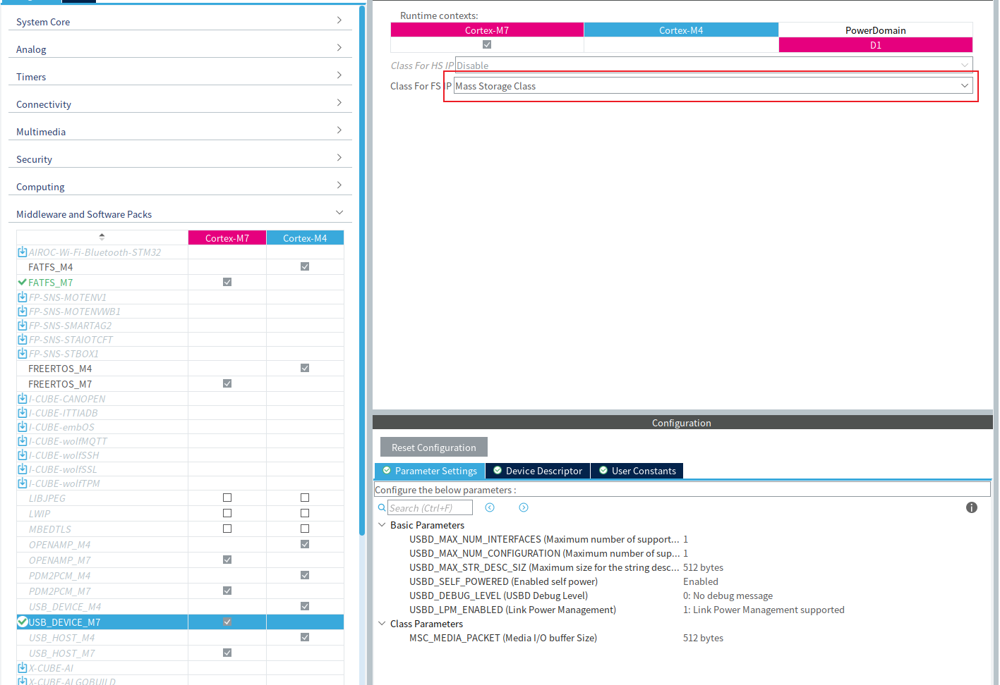
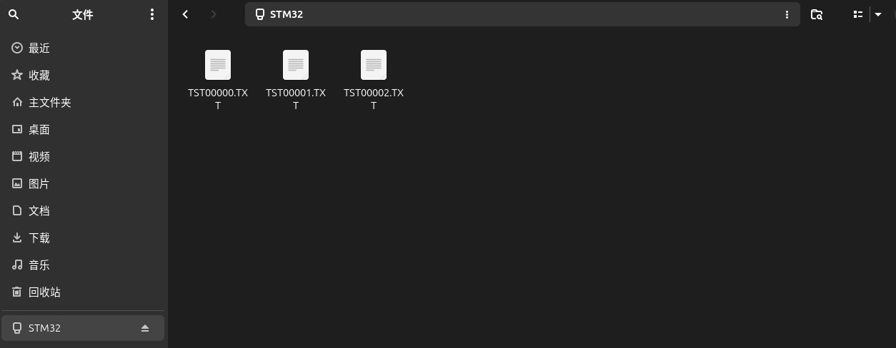

# 第一部分：USB 基础

## 1. 总线与物理层

USB 全称 **Universal Serial Bus**（通用串行总线），但它在物理上并不是一条像 I2C 那样挂满器件的共享线，而是**分层星形**拓扑：

```text
            主机（Host）
                │
            根集线器
           ┌────┼────┐
        设备  集线器  设备
                │
            ┌───┴───┐
          设备     设备
```

集线器（Hub）把上游链路分成多条下游链路，每条都是**点对点**的。所以"总线"描述的是**逻辑上的共享** —— 所有设备面对同一套地址、同一份时间；物理上每条链路只有主机和对面那一个设备。

**主机唯一，总线归主机独占**。设备不能主动发起传输，只能等主机点名。

D+ 和 D− 是一对差分线，但同一时刻只有一方驱动，是**半双工**。方向切换发生在**包**的粒度：主机发完一个包就释放总线，设备在规定的窗口内应答，然后主机收回。线路上看到的是"主机说一句、设备答一句"的交替。时钟信息编码在数据里，没有单独的时钟线。

### 连接检测与速率

**主机靠上拉电阻发现设备插入**。设备侧在 D+ 或 D− 上挂一个 `1.5 kΩ` 上拉，集线器每个端口有 `15 kΩ` 下拉。没有设备时两条线都被拉低；设备插上后，上拉把其中一条抬到约 `3 V`，主机立刻测到。

**上拉挂在哪根线上，同时说明这是什么速率的设备**：

| 上拉位置 | 速率      |
| ---- | ------- |
| D+   | 全速 / 高速 |
| D−   | 低速      |

因此设备上电后不能立刻通信 —— 主机要先看到上拉，再复位、枚举，才知道对面是谁。

**VBUS** 是线缆里的 `5 V` 电源线，和数据线分开，设备可以用它判断主机是否已供电。

USB 2.0 定义了三种速率：

| 名称         | 速率           | 批量传输的单个包上限 |
| ---------- | ------------ | ----------:|
| 低速（LS）     | `1.5 Mbit/s` | 不支持批量传输    |
| **全速**（FS） | `12 Mbit/s`  | **64**     |
| 高速（HS）     | `480 Mbit/s` | 512        |

> 低速只支持控制传输和中断传输，没有批量传输，所以大容量存储设备最低也只能跑全速。本文后面的帧、包、带宽计算都以全速为准。

## 2. 包、事务与帧

一次 USB 通信自下而上分成四层：

```text
传输（Transfer）          一次完整的读写
   └─ 帧（Frame）          1 ms 的时间窗口
        └─ 事务（Transaction）   令牌 + 数据 + 握手
             └─ 包（Packet）     线路上最小的一次收发
```

### 包

**包是线路上最小的单位**，由几段固定字段组成：

```text
| SYNC | PID | 数据字段 | CRC | EOP |
```

- **SYNC**：同步头，让接收方对齐位边界
- **PID**：包标识，说明这是哪一种包
- **数据字段**：内容随包类型而变
- **CRC**：校验
- **EOP**：包结束标志

按 PID 区分有四类：**令牌包**（主机发出，说明接下来做什么、找谁）、**数据包**、**握手包**（表示收到 / 拒收 / 忙）、**特殊包**（SOF）。

数据包在全速下最多 64 字节。这个"64"是**上限**而不是固定值 —— 数据不够时发一个更短的包，而不是补零填满。

### 事务

**一个事务由"令牌 → 数据 → 握手"三拍组成**，全部由主机起头：

```text
主机：发令牌（SETUP / IN / OUT）
        ↓
设备或主机：传数据
        ↓
接收方：回握手（ACK / NAK / STALL）
```

| 令牌      | 数据方向    | 用途     |
| ------- | ------- | ------ |
| `SETUP` | 主机 → 设备 | 发起控制传输 |
| `IN`    | 设备 → 主机 | 主机读数据  |
| `OUT`   | 主机 → 设备 | 主机写数据  |

方向是**站在主机的角度**说的 —— `IN` 是数据"进"主机。

### 帧

主机把时间切成固定长度的**帧**，每帧开头发一个 **SOF 包**（Start of Frame）作标记：

```text
|<---------------------- 1 ms ---------------------->|
[SOF][事务][事务][事务] · · · [事务]            [空闲]
```

| 项       | 全速                     |
| ------- | ---------------------- |
| 帧长度     | `1.000 ms ± 0.0005 ms` |
| SOF 包长度 | 约 `3 µs`（帧的 `0.3%`）    |
| 帧号      | 11 位，`0 ~ 2047` 循环     |
| 高速      | 每帧再切成 8 个 `125 µs` 的微帧 |

**只有主机会发 SOF，设备从不产生它**。它给所有设备一个共同的时间基准，也是带宽分配的容器。帧不是"有数据传输时才存在"，只要总线不挂起，主机就一直按 1 ms 发；反过来，**连续超过 3 ms 没有活动，总线进入挂起状态，SOF 停止**。

**一帧能传多少数据**？按线速率把帧长换算成比特：

```text
12 Mbit/s × 1 ms = 12000 bit = 1500 字节
```

但这 1500 字节是**比特预算** —— 这一帧总共有多少比特的时间，协议开销全算在里面，不是"能装 1500 字节数据"。一次 Bulk 事务的开销不小：

| 成分                               | bit       |
| -------------------------------- | ---------:|
| 令牌包（SYNC + PID + 地址 + 端点 + CRC5） | 32        |
| 包间隔与 EOP                         | ~5        |
| 数据包（SYNC + PID + 64 字节 + CRC16）  | 544       |
| 包间隔与 EOP                         | ~5        |
| 握手包（SYNC + PID）                  | 16        |
| EOP                              | ~2.5      |
| **合计**                           | **≈ 604** |

604 bit 里只有 512 bit（64 字节）是有效数据。按这个开销排下去，**一帧最多塞 19 个 64 字节的事务**：

```text
19 × 64 = 1216 字节/帧  →  1.216 MB/s
```

| 数字     | 含义                           |
| ------:| ---------------------------- |
| `1500` | 一帧的**比特预算**（线速率 × 帧长）        |
| `1216` | 一帧 Bulk **实际**能搬的上限（19 × 64） |
| `64`   | 单个**数据包**的上限                 |

> 实际还有位填充的开销 —— 连续 6 个 1 之后要插一个 0，保证接收方不丢失位同步。规范给出的 19 这个数字已经把它算进去了。

**帧的占用率取决于总线忙不忙**：空闲时只有 SOF，其余都是空闲；一旦有 Bulk 数据排队，主机会把帧填到约 `96%`。

## 3. 传输类型与短包

| 类型                  | 带宽保证    | 出错重传  | 典型用途          |
| ------------------- | ------- | ----- | ------------- |
| **控制**（Control）     | 预留      | 是     | 枚举、配置设备       |
| **批量**（Bulk）        | 无保证，填空闲 | 是     | 大容量数据，**U 盘** |
| **中断**（Interrupt）   | 定期预留    | 是     | 键盘、鼠标         |
| **等时**（Isochronous） | 定期预留    | **否** | 音频、视频         |

**大容量存储用的是批量传输**，因为它对**正确性**的要求远高于对时延的要求：数据量大，错一个字节文件就坏了，而 Bulk 有握手和重传，出错能发现；同时 Bulk 不预约带宽，只在别的传输用剩的时间里传，不浪费。代价是时延没有保证，读写速度会随总线忙闲波动。

### 短包

**数据不够 64 字节时不填充**。

"64 字节"是包的上限，不是格子。数据不满时发出的就是一个更短的包，它在物理上就短那么多，不是"装满 64 字节再补一堆 0"。传 31 字节就是一个 31 字节的包。

| 要发的长度 | 包数  | 最后一段      |
| -----:| ---:| ---------:|
| `31`  | 1   | 31 字节     |
| `13`  | 1   | 13 字节     |
| `512` | 8   | 64 字节 × 8 |
| `513` | 9   | 最后 1 字节   |

**短包还有个作用**：它是"传完了"的信号。长度没有事先约定时，接收方靠"收到一个不满最大长度的包"判断传输结束。所以短包不是没装满的残次品，而是协议里一个正经的终止符。

> **唯一会补零的是等时传输**。它的带宽按帧预约，节奏就是一切，宁可发一堆 0 把时间槽占住，也不让某一帧空着。其余三种传输都不填充。

还有一个相反的概念 —— **ZLP**（Zero-Length Packet，零长度包）：当数据长度正好是最大包长的整数倍时，"满包"有歧义，发送方有时会额外补一个 0 字节的包来明确结束。**填充**是"数据不够，补 0 凑满一个包"；**ZLP** 是"数据正好，额外发一个全是 0 的包"。

# 第二部分：MSC 协议

## 1. MSC 与两层协议

**MSC = Mass Storage Class**（大容量存储类），是存储设备用的一套 USB **设备类**。

USB 规范只定义**线路上怎么发字节**，没规定"U 盘该说什么话"。设备类补的就是这一层 —— 提前定好一门标准语言，把驱动内置进操作系统，所以 U 盘才能免驱。HID（键盘鼠标）、CDC（虚拟串口）、UVC（摄像头）同理。

> 一句话分工：**USB 管怎么运，设备类管运什么**。

### MSC 没有发明命令

**MSC 把已经存在的 SCSI 命令集，塞进 USB 的包里传**。于是它是两套协议叠在一起：

```text
┌───────────────────────────────────────┐
│ SCSI 命令集   "读第 100 号扇区起 8 个" │  ← 命令层：做什么
├───────────────────────────────────────┤
│ BOT 传输      "用 Bulk 端点分三段搬"   │  ← 传输层：怎么搬
├───────────────────────────────────────┤
│ USB 总线      包 / 事务 / 帧           │
└───────────────────────────────────────┘
```

**两层各自在接口描述符里占一个字段**：

| 字段                   | 值      | 回答               |
| -------------------- | ------ | ---------------- |
| `bInterfaceSubClass` | `0x06` | 用**哪套命令**？→ SCSI |
| `bInterfaceProtocol` | `0x50` | 用**哪种传输**？→ BOT  |

两个字段各有候选值，说明两层能各自替换：

| 命令集（SubClass）        | 值      | 传输（Protocol）            | 值               |
| -------------------- | ------ | ----------------------- | --------------- |
| RBC                  | `0x01` | Control/Bulk/Interrupt  | `0x00` / `0x01` |
| MMC-5（光驱）            | `0x02` | **Bulk-Only Transport** | `0x50`          |
| UFI（软驱）              | `0x04` | UAS                     | `0x62`          |
| **SCSI transparent** | `0x06` |                         |                 |

- **换传输层**：BOT 换 **UAS**，命令还是 SCSI，但允许多条命令并行（移动固态硬盘）
- **换命令层**：SCSI 换 **ATAPI**（光驱）或 **UFI**（软驱），外壳还是 CBW/CSW

**为什么要分两层**？复用。SCSI 比 USB 早得多，操作系统里早有成熟的磁盘驱动；USB 要接存储设备，最省事的做法就是**别重新发明命令集，直接把 SCSI 塞进 USB 包**，外面加个传输外壳。操作系统那边一层都不用改。

**LUN**（Logical Unit Number，逻辑单元号）表示"这个设备里有几个盘"：U 盘只有一个（`LUN = 0`），多卡读卡器则是 `0/1/2`。

## 2. CBW 与 CSW：三段式流程

**BOT = Bulk-Only Transport**（仅批量传输）。名字里的 **Only** 是关键：USB 有四种传输类型，MSC 规定**只用 Bulk 这一种**，不用控制、中断、等时。

一次命令固定三段：

```text
① CBW   (31 字节)   主机 → 设备   "我要读第 X 号扇区起 N 个扇区"
② DATA             双向         实际数据
③ CSW   (13 字节)   设备 → 主机   "做完了 / 失败了"
```

**CBW = Command Block Wrapper**（命令块包装）—— 它把一条 SCSI 命令**包**起来，外面加上几个 USB 用得上的字段：

| 字段            | 长度  | 含义                     |
| ------------- | ---:| ---------------------- |
| `dSignature`  | 4   | 签名 `'USBC'`，确认这确实是 CBW |
| `dTag`        | 4   | 标签，主机起的名，CSW 要原样还回     |
| `dDataLength` | 4   | 这次要传多少字节               |
| `bmFlags`     | 1   | 方向：主机要读还是写             |
| `bLUN`        | 1   | 操作哪个盘                  |
| `bCBLength`   | 1   | 后 16 字节里有效的是前几个        |
| `CB`          | 16  | **一条 SCSI 命令装在这里**     |

**4 + 4 + 4 + 1 + 1 + 1 + 16 = 31**。

**CSW = Command Status Wrapper**（命令状态包装），是设备给的回执：

| 字段             | 长度  | 含义                         |
| -------------- | ---:| -------------------------- |
| `dSignature`   | 4   | 签名 `'USBS'`                |
| `dTag`         | 4   | 原样还回 CBW 的 tag             |
| `dDataResidue` | 4   | 还剩多少字节没传（0 = 全传完）          |
| `bStatus`      | 1   | `0` 成功 / `1` 失败 / `2` 阶段错误 |

**4 + 4 + 4 + 1 = 13**。

三个字段最值得记：

| 字段             | 作用                                 |
| -------------- | ---------------------------------- |
| `dSignature`   | **验明正身** —— 防止把别的数据误当成命令           |
| `dTag`         | **配对** —— 主机可能连发命令，靠 tag 认领回执      |
| `dDataResidue` | **完整性** —— 说好 4096 字节，实收 4096 就是 0 |

> CBW 的 31 字节、CSW 的 13 字节，都不是 64 的整数倍，所以它们天然就是第一部分说过的**短包**。

## 3. SCSI 命令集与 LBA

CBW 里那 16 字节叫 **CDB**（Command Descriptor Block，命令描述块），第一个字节是**操作码**，说明这是哪一条命令。

存储设备实际用到的命令按用途分四组：

| 分组      | 命令                                    | 作用           |
| ------- | ------------------------------------- | ------------ |
| **认设备** | `INQUIRY`                             | 你是什么设备？      |
|         | `TEST_UNIT_READY`                     | 你在吗？（插上后反复问） |
|         | `REPORT_LUNS`                         | 你有几个盘？       |
| **问容量** | `READ_CAPACITY10` / `READ_CAPACITY16` | 你多大（多少个扇区）？  |
|         | `READ_FORMAT_CAPACITIES`              | 支持什么格式？      |
|         | `MODE_SENSE6` / `MODE_SENSE10`        | 你的参数（读写块大小）？ |
| **真干活** | `READ10` / `READ12`                   | **读扇区**      |
|         | `WRITE10` / `WRITE12`                 | **写扇区**      |
|         | `VERIFY10`                            | 校验扇区         |
| **管状态** | `REQUEST_SENSE`                       | 刚才为什么失败？     |
|         | `START_STOP_UNIT`                     | 启动 / 停止 / 弹出 |
|         | `ALLOW_MEDIUM_REMOVAL`                | 允许弹出吗（上锁）    |
|         | `RECEIVE_DIAGNOSTIC_RESULTS`          | 自检结果         |

**真正搬数据的命令只有两个**：`READ10` 和 `WRITE10`，其他都是打辅助的。

**命令名里的数字是 CDB 的字节数**：`READ10` 用 10 字节的命令块，`READ12` 用 12 字节。多出来的字节把传输长度字段从 2 字节扩到 4 字节 —— 一次能下的扇区更多；LBA 仍占 4 字节，要表达 2 TB 以上的盘才会用到 16 字节的 `READ16`。CBW 的 `CB` 固定 16 字节，用 `READ10` 时 `bCBLength` 就写 `10`。

一条 `READ10` 的 CDB 里装了什么：

```text
CB[0]    = 0x28          操作码，0x28 就是 READ10
CB[2..5] = LBA           从哪个扇区开始（4 字节）
CB[7..8] = 传输长度       读几个扇区（2 字节）
bmFlags  = 0x80          方向：主机要读
```

**LBA = Logical Block Address**（逻辑块地址），就是扇区号，从 0 开始，每个 512 字节。

要分清三个层次：

| 层次      | 是什么          | 谁定的       |
| ------- | ------------ | --------- |
| **扇区**  | 512 字节的固定单位  | 存储设备      |
| **LBA** | 扇区编号，从 0 开始  | SCSI      |
| **分区**  | 一组连续 LBA 的划分 | PC 侧的文件系统 |

**设备只认 LBA**，永远看不到"分区"。分区是 PC 在 LBA 之上自己算出来的 —— 同一张卡，PC 上可能显示成整卡和第一分区两个设备，其实只是两套编号方式。

## 4. 一次读扇区的完整流程

把前面三节串起来，看 PC 读 8 个扇区时走完的一整个回合：

```text
① 主机 → 设备    CBW（31 字节）
                 dSignature  = 'USBC'
                 dTag        = 0x1234
                 dDataLength = 4096
                 bmFlags     = 0x80（要读）
                 CB          = READ10 命令：LBA = 100，长度 = 8

② 设备 → 主机    数据（4096 字节）
                 每次 512 字节，分多次搬完

③ 设备 → 主机    CSW（13 字节）
                 dSignature   = 'USBS'
                 dTag         = 0x1234   ← 原样还回
                 dDataResidue = 0        ← 全传完了
                 bStatus      = 0        ← 成功
```

**这三段是严格串行的**：主机必须等 CSW 回来，才能发下一条 CBW。这是 BOT 最大的局限 —— 任何时候总线上只有一条命令在飞，延迟藏不住。UAS 之所以快，就是因为它允许同时有多条命令在路上。

**一次完整的"打开文件并读取内容"，PC 大概会经历**：

```text
TEST_UNIT_READY   → 确认介质在不在
READ_CAPACITY10   → 问总容量
READ10            → 读 FAT 表（文件在哪个簇）
READ10            → 读目录项（文件多长、起始簇）
READ10            → 读文件内容
```

**这些命令对设备来说都是同一件事** —— "读某个 LBA 起 N 个扇区"。设备完全不知道哪次读的是 FAT、哪次读的是文件内容；文件系统的含义只在 PC 那边成立。

# 第三部分：实际配置与软件实现

## 1. MSC 的 CubeMX 配置

本工程 `STM32H747/usb_msc` 是在 `STM32H747/sd_card` 的基础上加 USB 得到的。USB 外设本身（`USB_OTG_FS` 设为 `Device_Only`、`PA11`/`PA12`、48 MHz 走 `PLL1Q`）与 USB 虚拟串口一篇完全相同，SDMMC1 与 FatFs 的配置和 TF卡与 FatFs 一篇完全相同，这一节都不重复。

在 **Middleware and Software Packs → USB_DEVICE_M7** 中启用 USB Device，**Runtime contexts** 勾在 **Cortex-M7**（USB 协议栈由 CM7 运行），然后把 **Class For FS IP** 设为 **Mass Storage Class**。



选中这个类之后，CubeMX 会多生成一个文件 `CM7/USB_DEVICE/App/usbd_storage_if.c`，里面是一组**空回调** —— MSC 只知道"有个存储介质"，具体怎么读、怎么写要我们自己接上。

`Class Parameters` 里只有一个可调项：

| 选项                 | 本工程值        | 说明                    |
| ------------------ | ----------- | --------------------- |
| `MSC_MEDIA_PACKET` | `512` bytes | 库搬数据用的缓冲区大小，也是一轮最多搬多少 |

CubeMX 的默认值就是 512 bytes，本工程没有改。它决定库每次向我们要多少数据：主机发一条 `READ10` 说要读 64 KB，库不会一次要 64 KB，而是按 `MIN(剩余长度, MSC_MEDIA_PACKET)` 一轮一轮地搬 —— 64 KB 就是 128 轮。生成后它落在 `CM7/USB_DEVICE/Target/usbd_conf.h`。

之所以不往大调：本工程的 SD 卡读写是在 **USB 中断里轮询**完成的（见 §2 的调用链），这个值越大，单次进中断阻塞的时间越长。512 正好是一个扇区，一轮就是一次 `HAL_SD_ReadBlocks()`。

> 本工程没有给 SDMMC 配 DMA，也没有开 D-Cache，CPU 读到的就是内存里的最新数据。若要改用 DMA 或打开 D-Cache，DMA 会绕过 cache 直接写内存，缓冲区必须放进 MPU 的 non-cacheable 区（或每次传输前后做 cache 维护）并按 32 字节 cache line 对齐，否则会偶发读到旧数据。另外 MSC 类库的 `Read()` 是同步契约 —— 返回时数据必须已经到位，换成 DMA 就得把类库也改成异步。

## 2. 软件构成：三层各写什么

一次 `READ10` 从 USB 中断走到 SD 卡，中间经过三段代码：

```text
OTG_FS_IRQHandler()                                  CM7/Core/Src/stm32h7xx_it.c
   └─ HAL_PCD_IRQHandler()
        └─ MSC 类库（usbd_msc.c / usbd_msc_bot.c / usbd_msc_scsi.c）
             └─ USBD_Storage_Interface_fops_FS.Read   CM7/USB_DEVICE/App/usbd_storage_if.c
                  └─ usb_msc_read_blocks()            BSP/USB_MSC/usb_msc.c
                       └─ sd_card_read_blocks()       BSP/SD_CARD/sd_card.c
                            └─ HAL_SD_ReadBlocks()    轮询
```

| 文件                                     | 谁生成    | 我们写什么        |
| -------------------------------------- | ------ | ------------ |
| `CM7/USB_DEVICE/App/usbd_storage_if.c` | CubeMX | 只填 7 个回调的函数体 |
| `BSP/USB_MSC/usb_msc.c`                | 我们自己   | 门闸、容量、块读写    |
| `User/cm7_main.cpp`                    | 我们自己   | 上电自检与移交（§5）  |

上面表里的"门闸"是本工程的内部叫法，代码里没有这个词。它指 `usb_msc.c` 里的 `media_ready` 标志位：设备侧自检没做完之前，它让 `IsReady` 一律返回失败，把主机挡在卡外。为什么需要它放在 §5。

`usbd_storage_if.c` 里已经有 `USBD_Storage_Interface_fops_FS` 这张函数指针表，由 CubeMX 生成的 `MX_USB_DEVICE_Init()` 注册进协议栈：

```c
if (USBD_MSC_RegisterStorage(&hUsbDeviceFS, &USBD_Storage_Interface_fops_FS) != USBD_OK)
```

这一句在 USER CODE 段之外，重新生成代码会被覆盖。所以这个文件里只放最小的翻译工作 —— 把我们自己写的 BSP 层返回的 `bool` 转成 `USBD_OK` / `USBD_FAIL`，真正的判断逻辑放在 `BSP/USB_MSC/usb_msc.c`，那个文件 CubeMX 不会碰。

## 3. 七个存储回调与调用时机

回调的类型定义在 `usbd_msc.h`：

```c
typedef struct _USBD_STORAGE
{
  int8_t (* Init)(uint8_t lun);
  int8_t (* GetCapacity)(uint8_t lun, uint32_t *block_num, uint16_t *block_size);
  int8_t (* IsReady)(uint8_t lun);
  int8_t (* IsWriteProtected)(uint8_t lun);
  int8_t (* Read)(uint8_t lun, uint8_t *buf, uint32_t blk_addr, uint16_t blk_len);
  int8_t (* Write)(uint8_t lun, uint8_t *buf, uint32_t blk_addr, uint16_t blk_len);
  int8_t (* GetMaxLun)(void);
  int8_t *pInquiry;

} USBD_StorageTypeDef;
```

| 回调                 | 被谁调用                                                  | 时机                        | 本工程返回                       |
| ------------------ | ----------------------------------------------------- | ------------------------- | --------------------------- |
| `Init`             | `MSC_BOT_Init()`                                      | 主机发 `SET_CONFIGURATION`   | `USBD_OK`                   |
| `GetMaxLun`        | `BOT_GET_MAX_LUN` 类请求（`0xFE`）                         | 枚举时主机问"有几个盘"              | `0`                         |
| `IsReady`          | `SCSI_TestUnitReady` / `SCSI_Read10` / `SCSI_Write10` | `TEST_UNIT_READY`，以及每次读写前 | 门闸 + `sd_card_wait_ready()` |
| `GetCapacity`      | `SCSI_ReadCapacity10/16`、`SCSI_ReadFormatCapacities`  | 主机问总容量                    | `sd_card_get_info()`        |
| `IsWriteProtected` | `SCSI_Write10/12`                                     | 每次写之前                     | `USBD_OK`（不做写保护）            |
| `Read`             | `SCSI_ProcessRead`                                    | `READ10` / `READ12`       | `sd_card_read_blocks()`     |
| `Write`            | `SCSI_ProcessWrite`                                   | `WRITE10` / `WRITE12`     | `sd_card_write_blocks()`    |

四点值得单独说：

- **`pInquiry` 不是回调**，是 `INQUIRY` 直接返回的那 36 字节（厂商、型号、版本）。库按 `pInquiry[lun * 36]` 取，所以改 `STORAGE_Inquirydata_FS` 就能改 PC 上看到的设备型号。
- **`Init` 每次插上都会调用**。主机重新枚举时会再发一次 `SET_CONFIGURATION`，所以不能在这里复位"自检已完成"的门闸，否则状态会被清掉。本工程里它只返回 `USBD_OK`。
- **不是所有 SCSI 命令都会到我们这里**。`INQUIRY`、`REQUEST_SENSE`、`MODE_SENSE`、`REPORT_LUNS` 都由库自己回答，只有真正要碰介质的命令才调回调。
- **`lun` 参数恒为 0**。本工程只暴露一个盘（`STORAGE_LUN_NBR` 为 1），`GetMaxLun` 返回 0，回调里的 `lun` 可以直接忽略。

## 4. 回调实现

七个回调里，四个有实际内容：

```c
int8_t STORAGE_IsReady_FS(uint8_t lun)
{
  UNUSED(lun);

  // 上电自检完成前返回失败，主机会在 TEST_UNIT_READY 上重试。
  return usb_msc_is_media_ready() ? USBD_OK : USBD_FAIL;
}

int8_t STORAGE_GetCapacity_FS(uint8_t lun, uint32_t *block_num, uint16_t *block_size)
{
  UNUSED(lun);

  return usb_msc_get_capacity(block_num, block_size) ? USBD_OK : USBD_FAIL;
}

int8_t STORAGE_Read_FS(uint8_t lun, uint8_t *buf, uint32_t blk_addr, uint16_t blk_len)
{
  UNUSED(lun);

  return usb_msc_read_blocks(buf, blk_addr, blk_len) ? USBD_OK : USBD_FAIL;
}

int8_t STORAGE_Write_FS(uint8_t lun, uint8_t *buf, uint32_t blk_addr, uint16_t blk_len)
{
  UNUSED(lun);

  return usb_msc_write_blocks(buf, blk_addr, blk_len) ? USBD_OK : USBD_FAIL;
}
```

另外三个是常量：`Init`、`IsWriteProtected` 返回 `USBD_OK`，`GetMaxLun` 返回 `STORAGE_LUN_NBR - 1`。

BSP 层里对应的读写就是这个样子：

```c
bool usb_msc_read_blocks(uint8_t* data, uint32_t block_address, uint32_t block_count)
{
    return sd_card_read_blocks(data, block_address, block_count, USB_MSC_TIMEOUT_MS);
}
```

几个要点：

- **`blk_addr` 就是第一部分说的 LBA，`blk_len` 是块数不是字节数**。库在调用之前已经算好：`Read(lun, hmsc->bot_data, p_scsi_blk->addr, len / p_scsi_blk->size)`，所以回调里不需要再做字节和扇区的换算。
- **走裸块 API，不走 FatFs**。MSC 本身就是块设备 —— 主机要的是"第几个 512 字节扇区"，FAT 表由主机那边解析。设备侧再套一层 FatFs 既多余，又会和主机争同一张卡。
- **超时 `USB_MSC_TIMEOUT_MS` 为 1000 ms**。底层是轮询的 `HAL_SD_ReadBlocks()`，超时就返回失败，库会把 CSW 的 `bStatus` 置成失败，主机收到一个读错误。
- **`IsReady` 里不只看门闸**，还调 `sd_card_wait_ready()`：卡被拔掉或换了一张，下一次 `TEST_UNIT_READY` 就会失败，主机会重新去读容量。

## 5. 上电自检与介质移交

`main.c` 里的调用顺序是关键：

```c
MX_SDMMC1_SD_Init();
MX_FATFS_Init();
MX_USB_DEVICE_Init();   // 到这一步 D+ 上拉已经接上，主机可以开始枚举
cm7_main();             // 自检这时才开始
```

**USB 比自检先启动**，所以主机完全可能在 FatFs 还在读写校验的时候就发 `READ10` 过来。设备侧不能一边用 FatFs 写卡、一边让主机读同一张卡 —— FAT 是单主文件系统，两个主同时改会直接破坏文件系统。这就是门闸存在的理由。

`cm7_main()` 的流程：

```cpp
// ① 卡信息自检：确认卡已就绪并打印容量
// ② FatFs 自检：建文件 → 写 → 关 → 重开 → 回读 → memcmp
// ③ 给卡写卷标，PC 上显示为 STM32
f_mount(NULL, SDPath, 0);        // 卸载 FatFs
usb_msc_set_media_ready(true);   // 开门闸，此后设备侧不再碰卡

for (;;) {
    delay_ms(1000);
}
```

门闸就是 `usb_msc.c` 里的一个静态变量，`usb_msc_is_media_ready()` 不只看它，还要确认卡当前处于就绪状态：

```c
bool usb_msc_is_media_ready(void)
{
    if (!media_ready) {
        return false;
    }

    return sd_card_wait_ready(0U);
}
```

门闸关闭期间 `IsReady` 返回失败，库回一个 `NOT_READY / MEDIUM_NOT_PRESENT` 的 sense，主机的反应是**过一会儿再问一次** `TEST_UNIT_READY`。也就是说重试是主机自己做的：设备侧既不需要状态机，也不需要延时等自检完成，返回失败就够了。

自检完成后卸载 FatFs 是必须的：卷标和自检写入的 `TSTnnnnn.TXT` 是设备侧最后动过的数据，之后 FAT 表可能被主机改写，设备侧若还拿着旧的 FatFs 缓存去读，会读到不一致的内容。所以移交之后 `cm7_main()` 只剩一个空转循环，卡完全归主机。

# 第四部分：实际现象

## 1. 测试环境

STM32H747 的 Cortex-M7，`USB_OTG_FS`（`PA11` 为 D−、`PA12` 为 D+，全速 12 Mbit/s），一张 32 GB 的 TF 卡，卡上是 FAT32。电脑用 Ubuntu 自带的文件管理器看盘。电脑要接在 `PA11`/`PA12` 那个 USB 插座上。

日志由 USART1 输出，串口终端按 **115200、8 位数据位、无校验、1 位停止位**查看。

完整工程：[STM32H747/usb_msc](https://github.com/fazhehy/STM32-HAL-Drivers/tree/main/STM32H747/usb_msc)。

## 2. 上电自检与电脑上出现的盘

上电后串口先打印两行自检结果：

```text
[=LOG=]: SD: block_number=62333952 block_size=512
[=LOG=]: FatFs test passed: 0:/TSTnnnnn.TXT
```

62333952 × 512 ≈ 31.9 GB，就是这张卡的容量；第二行说明建文件、写入、回读、`memcmp` 那一串校验全过了。

这两行出来之前门闸还关着，电脑上的盘也不会出现 —— 电脑这时已经在发 `TEST_UNIT_READY`，`IsReady` 一直返回失败，它就过一会儿再问一次。所以上电后插上线到看见盘符之间的停顿，是自检在跑。

自检通过后电脑上出现一个可移动盘，卷标 `STM32`：



根目录里那几个 `TSTnnnnn.TXT` 就是自检写的文件。自检在设备侧，文件却在电脑上看得见 —— **设备只搬扇区，文件系统由电脑解析**。图上三个文件，说明这块卡跑过三次自检。

## 3. 已知限制

- **移交之后设备侧不再访问卡**。`f_mount(NULL, SDPath, 0)` 卸载 FatFs 之后只剩空转循环，所以设备固件不能再用 FatFs 读写这张卡 —— FAT 是单主文件系统，两边同改会破坏它。
- **没有写保护**。`STORAGE_IsWriteProtected_FS()` 直接返回 `USBD_OK`，电脑可以随便写，包括格式化。
- **不支持热插拔换卡**。卡座没有卡检测引脚，`sd_card_init()` 只在自检时调一次，换卡要重新上电。
- **速度上限是全速 USB 的 1.216 MB/s**，这是第一部分的批量上限，实际更低；本文没做吞吐实测。

> 上面的现象来自一块卡、一台电脑上的几次插拔，长期插拔和大文件持续读写没测。编译通过与硬件验证是两回事。
