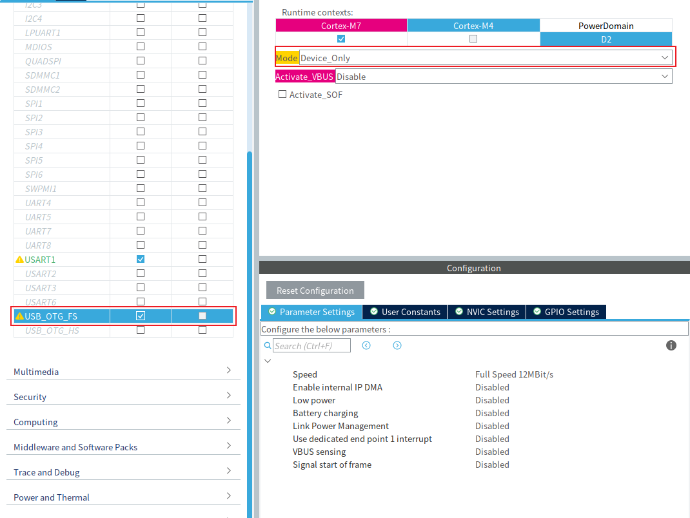
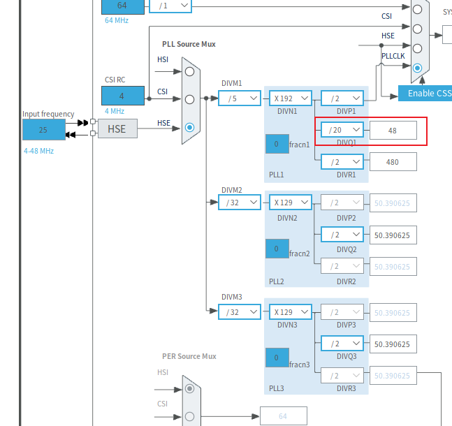
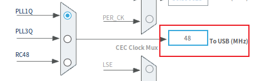
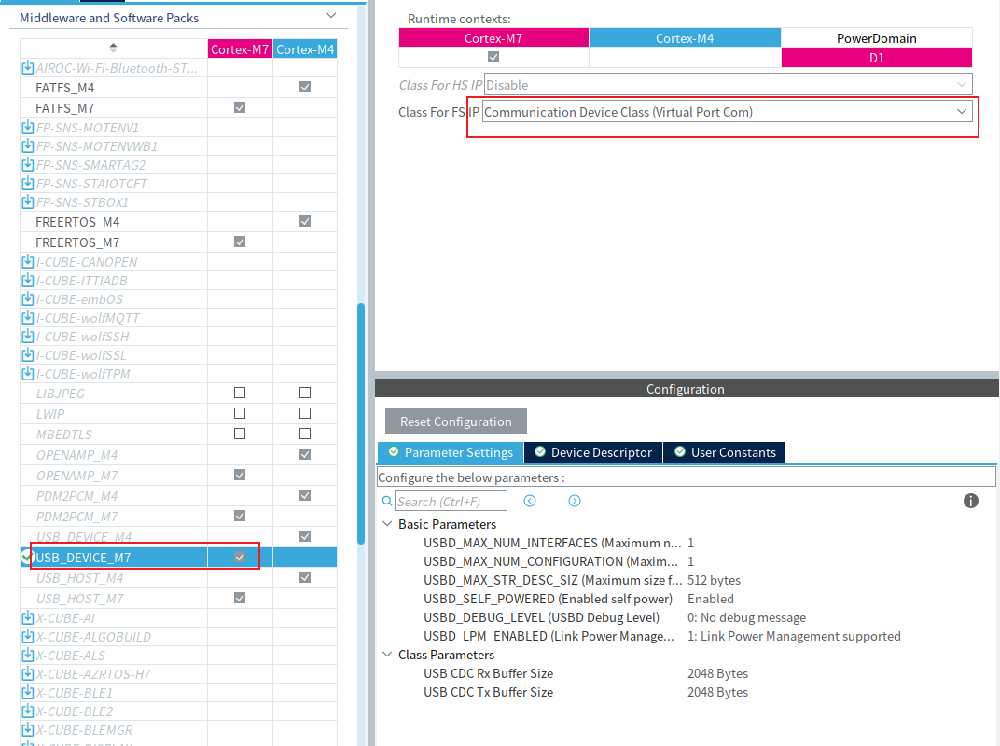

# 第一部分：USB 虚拟串口原理

## 1. USB 基础

USB 是 **Universal Serial Bus** 的缩写，用于连接电脑和各种外部设备。一次 USB 通信中，两端的角色不同：**Host（主机）**负责发现设备并发起通信，**Device（设备）**响应主机的请求。在本文的场景中，电脑是 Host，STM32H747 是 Device。

```text
电脑（Host）←→ USB 连接 ←→ STM32H747（Device）
```

设备接入后，电脑会读取设备提供的描述信息，并选择相应的配置。这个识别过程称为**枚举**。枚举完成后，电脑才能按照设备声明的功能与它通信。USB 设备可以表现为键盘、U 盘或其他类型；接上 USB 线并不会自动变成串口。[USB-IF 的 USB 2.0 规范](https://www.usb.org/document-library/usb-20-specification)定义了这些基本通信机制。

## 2. USB 虚拟串口

**VCP（Virtual COM Port）**意为虚拟串口：电脑把 USB 设备呈现为一个串口，应用程序可以用串口软件收发数据，但实际传输走的是 USB，并不需要 STM32 的 UART TX/RX 引脚。

常见实现方式是 **CDC ACM**。CDC 是 USB 的通信设备类（Communications Device Class），ACM 是其中的抽象控制模型（Abstract Control Model）。STM32 的 USB Device 库提供 CDC 类，用于实现虚拟串口。[ST 的 USB 介绍](https://wiki.st.com/stm32mcu/wiki/USB_overview)对此有说明。

```text
连接 USB → 电脑枚举 STM32 → 电脑出现虚拟串口 → 双方收发数据
```

因此，虚拟串口描述的是电脑上看到的接口形式；USB CDC 描述的是 STM32 向电脑声明并实现这一功能所用的设备类。

# 第二部分：STM32H747 的 USB 系统

## 1. 两路 USB 外设与 PHY

STM32H747 提供 `USB_OTG_FS` 和 `USB_OTG_HS` 两路独立的 USB 控制器。它们都能作为 USB Device 或 Host 使用，但支持高速传输的硬件条件不同：

| 外设         | 使用芯片内置 PHY | 达到 USB 高速模式的条件                        |
| ------------ | ---------------- | ---------------------------------------------- |
| `USB_OTG_FS` | FS，12 Mbit/s    | 不支持 480 Mbit/s                              |
| `USB_OTG_HS` | FS，12 Mbit/s    | 通过 ULPI 接口连接外部 HS PHY，达到 480 Mbit/s |

**PHY** 负责 USB 线路上的电信号收发。STM32H747 内置的 PHY 支持 FS；`USB_OTG_HS` 名称中的 HS 表示控制器具有高速能力，并不表示只要选中它就会以 480 Mbit/s 运行。要达到这一速率，还需要外接 HS PHY 及相应的 ULPI 连线。[STM32H747 数据手册](https://www.st.com/resource/en/datasheet/stm32h747xi.pdf)给出了这两路外设的能力和限制。

本工程使用 `USB_OTG_FS` 和芯片内置 PHY，因此按 FS 速率工作，不需要外接 ULPI PHY。

## 2. USB 运行所需的硬件条件

USB 接口的 **D+、D−** 负责数据传输。在本工程的配置中，`PA12` 是 `USB_OTG_FS_DP`，`PA11` 是 `USB_OTG_FS_DM`。能否与电脑通信，还取决于板上的 USB 插座是否实际连接到这些引脚。

**VBUS** 是 USB 接口的 5 V 电源线。设备可以用它判断 USB 主机是否已连接；是否启用 VBUS 检测，需要依据板子的接线决定。它与 D+、D− 的数据功能不同。

## 3. CM7 上的 USB 软件链路

本工程将 USB Device 和 CDC 类放在 CM7。数据从应用程序到电脑，依次经过以下层次；电脑发送数据时方向相反：

```text
CM7 应用程序
    ↓
USB Device 库 / CDC 类
    ↓
HAL PCD 驱动
    ↓
USB_OTG_FS 与内置 FS PHY
    ↓
D+ / D− ↔ 电脑
```

其中，USB Device 库处理设备枚举和通用 USB 请求，CDC 类实现虚拟串口所需的通信接口，HAL PCD 驱动负责操作芯片的 USB 外设。当前工程在 CM7 初始化 USB Device，并通过 `CDC_Transmit_FS()` 周期发送测试字符串；接收回调目前仅重新准备下一次接收，尚未把收到的数据交给应用处理。

# 第三部分：实际配置

## 1. 配置目标

本文使用 `STM32H747/vcp` 工程，目标是让 STM32H747 作为 USB Device 接入电脑，并通过 CDC 虚拟串口每秒发送一行测试文本。

本例使用 `USB_OTG_FS`：D− 对应 `PA11`，D+ 对应 `PA12`。连接电脑时，应使用接到这组 USB 引脚的接口；如果硬件另有 USB 转 UART 接口，它不属于本例的 USB CDC 通道。

## 2. USB_OTG_FS 配置

在 CubeMX 的 **Connectivity → USB_OTG_FS** 中，将模式设为 **Device_Only**。本工程使用芯片内置 FS PHY，生成的底层配置为 `PCD_SPEED_FULL` 和 `PCD_PHY_EMBEDDED`，即 12 Mbit/s 的 FS 模式。



CubeMX 会把 `PA11` 分配为 D−、`PA12` 分配为 D+，并启用 `OTG_FS` 全局中断。配置后可在 Pinout 页面确认引脚没有被其他外设占用。此处无需启用 `USB_OTG_HS` 或配置 ULPI 引脚。

本工程把 `PA9` 用作 `USART1_TX`，USB 外设的 VBUS sensing 设为 Disabled。这个选项应按实际硬件的 VBUS 检测接线选择，不能只照搬截图。

## 3. 48 MHz 时钟配置

USB FS 外设需要 48 MHz 时钟。本工程采用 25 MHz HSE，经 `PLL1Q` 提供 USB 时钟：

```text
PLL1 输入 = 25 MHz ÷ DIVM1(5) = 5 MHz
PLL1 VCO  = 5 MHz × DIVN1(192) = 960 MHz
PLL1Q     = 960 MHz ÷ DIVQ1(20) = 48 MHz
```



在 CubeMX 的 **Clock Configuration** 中，检查 `USB Clock Mux` 选择 `PLL1Q`，右侧 `To USB` 显示 **48 MHz**。`PLL1P` 仍通过除以 2 得到 480 MHz 的 CM7 系统时钟；这个 480 MHz 不是 USB 时钟，也不会把 USB FS 变成 480 Mbit/s。



## 4. USB_DEVICE_M7 与 CDC 配置

在 **Middleware and Software Packs → USB_DEVICE_M7** 中启用 USB Device，并将 **Class For FS IP** 设为 **Communication Device Class (Virtual Port Com)**。本工程由 CM7 运行 USB 协议栈，因此选择 M7 对应的中间件。生成代码中的 `MX_USB_DEVICE_Init()` 会初始化 USB Device、注册 CDC 类并启动设备。



下面几个选项应与硬件和功能保持一致：

| 选项                | 本工程当前生成值 | 使用时要确认                                                                                           |
| ------------------- | ---------------- | ------------------------------------------------------------------------------------------------------ |
| VBUS sensing        | Disabled         | 本工程 PA9 用于 USART1_TX；是否启用检测需按实际 VBUS 接线决定。                                        |
| `USBD_SELF_POWERED` | `1`（Enabled）   | 若设备只靠 USB 的 VBUS 供电，应改为 `0`；若由独立电源供电，再按实际电路选择。                          |
| `USBD_LPM_ENABLED`  | `1`（Enabled）   | 底层 `lpm_enable` 当前为 Disabled；普通 CDC 测试无需 LPM，建议在 CubeMX 中关闭该选项，使两层配置一致。 |

这里的 `HAL_PWREx_EnableUSBVoltageDetector()` 用于 USB 3.3 V 供电检测，**不等于启用了外部 VBUS 引脚检测**。修改上述中间件参数后应重新生成代码，再核对 `usbd_conf.h` 与 `usbd_conf.c`。

## 5. CM7 测试代码

生成的 CM7 `main.c` 先调用 `MX_USB_DEVICE_Init()`，然后进入 `cm7_main()`。当前 `User/cm7_main.cpp` 中的测试代码如下：

```cpp
#include "cm7_main.h"

#include "delay.h"
#include "usbd_cdc_if.h"

extern "C" USBD_HandleTypeDef hUsbDeviceFS;

static void test_usb_cdc(void)
{
    static uint8_t message[] = "CM7 USB CDC OK\r\n";

    if (hUsbDeviceFS.dev_state == USBD_STATE_CONFIGURED) {
        (void)CDC_Transmit_FS(message, sizeof(message) - 1U);
    }
}

void cm7_main(void)
{
    for (;;) {
        test_usb_cdc();
        delay_ms(1000);
    }
}
```

发送前先判断设备是否完成配置，避免尚未枚举时调用 CDC 发送函数。发送缓冲区使用 `static`，保证 USB 传输期间数据仍然有效。代码每秒尝试发送一次；若前一次传输仍在进行，`CDC_Transmit_FS()` 可能返回 `USBD_BUSY`，这一轮数据便不会发送。

当前程序只演示 STM32 **向电脑发送**。`CDC_Receive_FS()` 收到电脑数据后仅重新准备接收，没有做回显或其他应用处理，因此在串口软件里输入文字不会自动收到回显。

完整工程：[STM32H747/vcp](https://github.com/fazhehy/STM32-HAL-Drivers/tree/main/STM32H747/vcp)。
